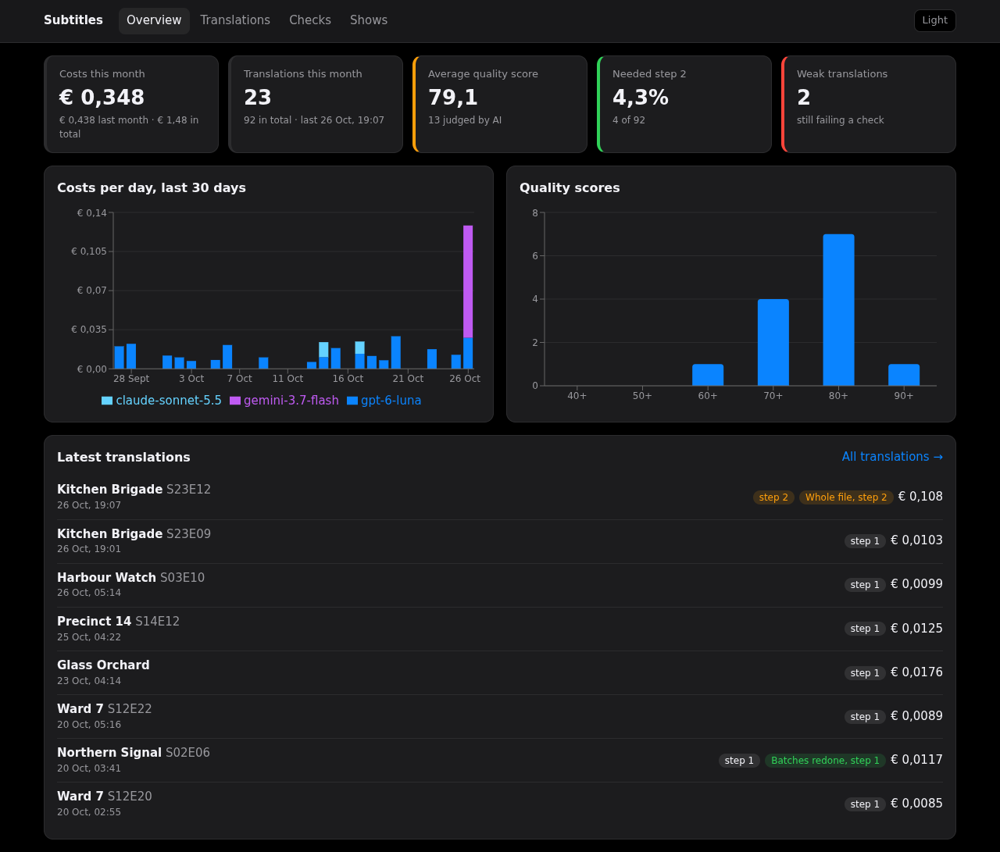
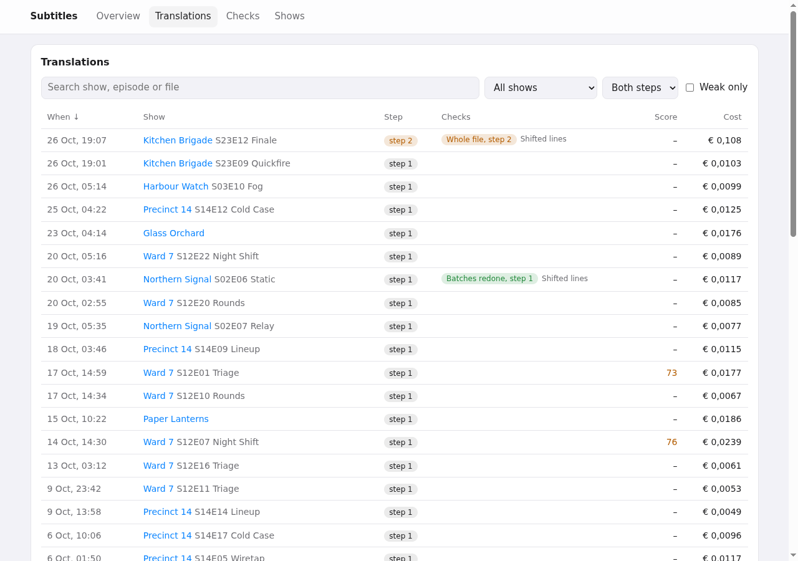
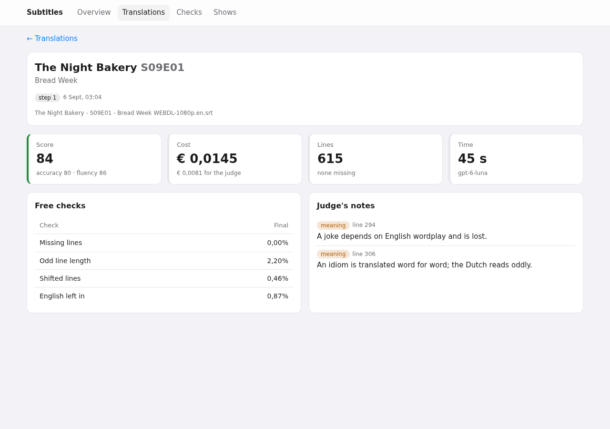
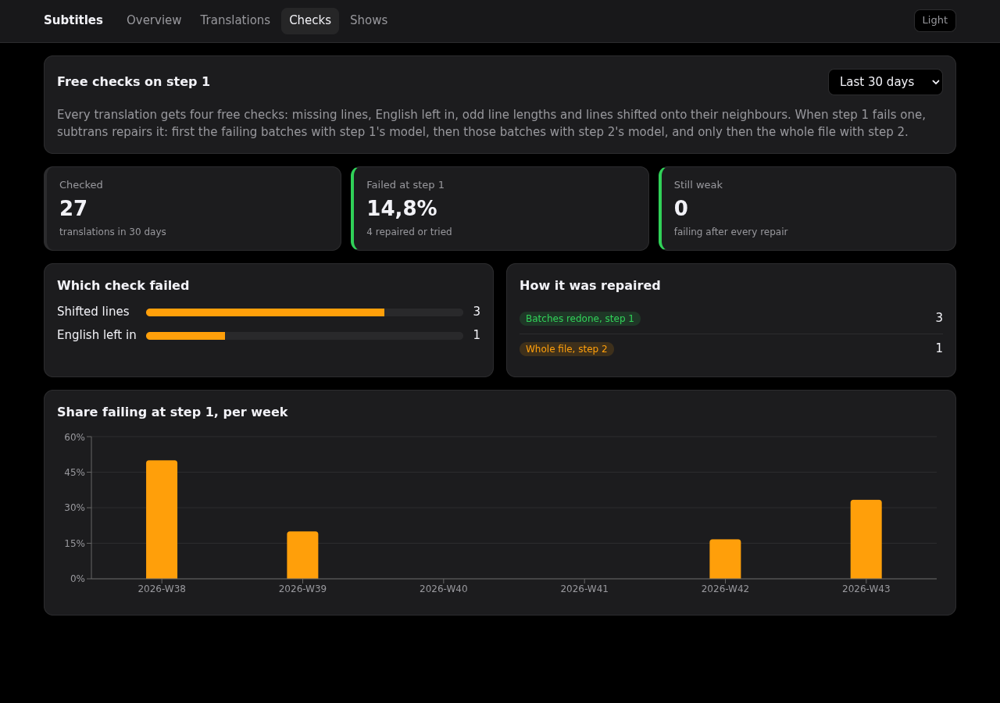
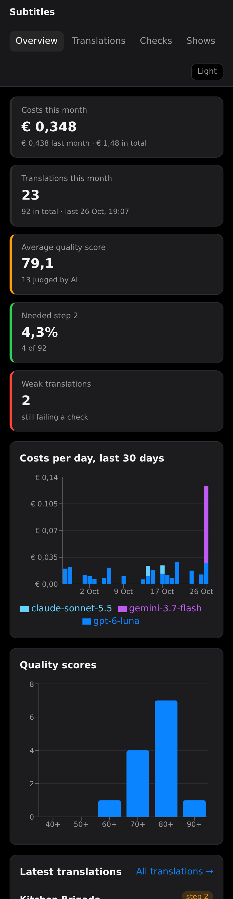

# subtitle-dashboard

A dashboard for the costs and quality of my [subtitle translation service](https://github.com/DonnyWeijers/llm-subtitle-translation)
(subtrans), which translates missing Dutch subtitles with LLMs on my homelab.

- **Rust** API (axum + SQLite) that reads subtrans' own log files
- **React + TypeScript** frontend, with types generated from the API's OpenAPI spec
- One small container: a static binary and the built frontend on a distroless image (~20 MB)

All amounts are in euros.

## Getting started

The repo includes a fake subtrans data folder in `example/` (made-up shows, ~90 translations over 75 days), so you
can try the dashboard without subtrans. To run it on your own subtrans data, see
[Run it next to subtrans](#run-it-next-to-subtrans-homelab).

### Option 1: Docker

Needs Docker with Compose. Nothing else.

```sh
git clone https://github.com/DonnyWeijers/subtitle-dashboard.git
cd subtitle-dashboard
python3 scripts/make-example-data.py   # optional: move the example dates up to today
docker compose up --build
```

Open <http://localhost:8795>. Stop it with `Ctrl+C`, or `docker compose down` when it runs in the background (`-d`).

### Option 2: locally, without Docker

Needs [Rust](https://rustup.rs) (stable) and [Node.js](https://nodejs.org) 24.

```sh
git clone https://github.com/DonnyWeijers/subtitle-dashboard.git
cd subtitle-dashboard
cd web && npm ci && npm run build && cd ..   # build the frontend into web/dist
DATA_DIR=example cargo run --release         # API and frontend on http://localhost:8080
```

### Option 3: development, with hot reload

Two terminals:

```sh
DATA_DIR=example cargo run           # 1: API on http://localhost:8080
cd web && npm ci && npm run dev      # 2: frontend on http://localhost:5173, /api proxied to :8080
```

The frontend reloads on save; restart `cargo run` after an API change.

### About the example data

The summary shows *this* month, so the example data ages. `python3 scripts/make-example-data.py` (Python 3, no
packages) writes it again with dates up to today; the numbers stay the same (fixed seed).

## Screenshots



<details>
<summary>More screenshots: translations, detail, checks, phone</summary>

**Translations**: search, filter on show, step or weak, sort on any column



**Detail**: the judge's notes per line, the free checks and the repair passes



**Checks**: how often step 1 fails a free check, which one, and how it was repaired



**On a phone**



</details>

The screenshots use the example data in `example/` (made-up shows).

## Tech stack

| Part | Built with |
|---|---|
| API | [Rust](https://www.rust-lang.org) (2024 edition), [axum](https://github.com/tokio-rs/axum) on [Tokio](https://tokio.rs), [tower-http](https://github.com/tower-rs/tower-http) for the static files |
| Data | [SQLite](https://sqlite.org) in memory via [rusqlite](https://github.com/rusqlite/rusqlite) (bundled), [serde](https://serde.rs) for the JSON files |
| API spec | [utoipa](https://github.com/juhaku/utoipa): OpenAPI 3.1 from the Rust types, served at `/api/openapi.json` |
| Frontend | [React](https://react.dev) 19, [TypeScript](https://www.typescriptlang.org), [Vite](https://vite.dev), [React Router](https://reactrouter.com) |
| Data fetching | [TanStack Query](https://tanstack.com/query) with [openapi-fetch](https://openapi-ts.dev/openapi-fetch/): typed calls, types generated by [openapi-typescript](https://openapi-ts.dev) |
| Charts | [Recharts](https://recharts.org) |
| Styling | Plain CSS with colour tokens; dark by default, light with a button (remembered per browser); works at phone width |
| Tests | `cargo test` (unit + API tests on fixtures), [Vitest](https://vitest.dev) + [Testing Library](https://testing-library.com) |
| Quality | rustfmt, Clippy, [ESLint](https://eslint.org) + typescript-eslint, `tsc --strict` |
| Container | Multi-stage Dockerfile: Node builds the frontend, Rust builds a static musl binary, [distroless](https://github.com/GoogleContainerTools/distroless) `static` runtime as non-root (~20 MB) |
| CI/CD | GitHub Actions, [cargo-deny](https://github.com/EmbarkStudios/cargo-deny), `npm audit`, [Trivy](https://trivy.dev) image scan, images to GHCR on a `v*` tag |
| Updates | [Renovate](https://docs.renovatebot.com) for cargo, npm, Docker and Actions |
| Example data | Python 3 (stdlib only) |

MIT licence, see [LICENSE](LICENSE).

## What it shows

| Page | |
|---|---|
| Overview | Costs this month, translations, average quality score, how often step 2 was needed, weak translations; costs per day per model; score distribution |
| Translations | Every translation, with search, filters (show, step, weak) and sorting; links to the detail page |
| Detail | Score and the AI judge's notes per line, the free checks before and after the repair, the repair passes, cost and time |
| Checks | How often step 1 fails a free check, which check, how the failures were repaired, per week |
| Shows | Translations, quality, step 2 and spend per show |

## How it works

```
subtrans' data folder (read-only)      subtitle-dashboard                         browser
  costs.jsonl  one line per API call ─┐
                                      ├─▶ ingest every 15 s ─▶ SQLite (memory) ─▶ /api/* ─▶ React
  state.json   one entry per subtitle ┘
```

- subtrans is never written to; the folder is mounted read-only.
- `costs.jsonl` is append-only: only new, complete lines are read, from the byte offset reached last time.
  A line without its newline is still being written and waits for the next poll. A file that got shorter was
  replaced and is read again from the start.
- `state.json` is re-read when its modification time or size changes. A file caught mid-write doesn't parse;
  the old data stays until the next poll.
- SQLite runs in memory: it is a cache that is rebuilt from the files on every start, so there is nothing to back up.
- subtrans logs OpenRouter's exact cost in dollars; it is converted at `EUR_PER_USD` (the same rate subtrans uses).
- Test runs are counted in the costs but left out of everything about translations, like subtrans' own stats.

### The repair route

subtrans runs four free checks on every translation (missing lines, English left in, odd line lengths, lines shifted
onto their neighbours). When step 1 fails one, it repairs the file: first only the failing 100-line batches with
step 1's model, then those batches with step 2's model, and only if the file still fails, the whole file with step 2.
The dashboard classifies every repair:

| `repair` | |
|---|---|
| `step1-batches` | Redoing the failing batches with step 1's model was enough |
| `step2-batches` | The failing batches needed step 2's model |
| `step2-file` | The whole file was redone with step 2's model |
| `unfixed` | Still failing a check after every pass: a weak translation |

## Performance

Measured on the homelab (Intel i5-13500), release build, against subtrans' real data (150 translations, 1,970 calls)
and a 30× larger copy of the example data (4,600 translations, 43,450 calls):

| | Real data | 30× larger |
|---|---|---|
| Memory (RSS) | 2.8 MiB idle in the container, 18 MiB after the load test | 83 MiB after the load test |
| Start, files read and serving | 23 ms | 254 ms |
| API response, one client (p50) | 0.03–1.7 ms per endpoint | 2–33 ms per endpoint |
| API throughput, 16 clients | 550–2,400 requests/s per endpoint (33,000/s for `/api/health`) | 23–620 requests/s |
| Frontend (`/`), one client (p50) | 0.36 ms | 0.36 ms |
| Image | 20 MB | |

- Queries share one in-memory SQLite connection behind a mutex, so they run one at a time; with a single user and
  data that changes every few minutes that is plenty. The slowest queries scan all calls (`/api/costs?group=day`,
  `/api/checks`); a cache per ingest would make them as fast as `/api/health` if the data ever grows that far.
- Sockets use `TCP_NODELAY`. Without it, file responses (headers and body written separately) waited ~40 ms each
  for the client's delayed ACK.

**How fresh is the data?** The API reads new lines from subtrans' files every 15 s (`POLL_SECONDS`). The pages
refetch every 60 s, and when the browser tab gets focus again.

## API

`GET /api/openapi.json` has the full spec.

| Endpoint | |
|---|---|
| `GET /api/summary?month=YYYY-MM` | Totals for a month (default: this month) and the score distribution |
| `GET /api/costs?group=day\|month\|model\|show&from=&to=` | Costs; `day` and `month` are split per model |
| `GET /api/translations?show=&weak=&step=&q=&sort=at\|score\|eur\|show&order=&page=&per_page=` | Paged list |
| `GET /api/translations/{id}` | One translation; the id is a stable hash of the subtitle's path |
| `GET /api/checks?days=30` | Free checks on step 1 and the repairs |
| `GET /api/shows` | Per show |
| `GET /api/health` | Rows read, lines skipped, last read, last error |

## Configuration

| Variable | Default | |
|---|---|---|
| `DATA_DIR` | `/data` | subtrans' data folder |
| `EUR_PER_USD` | `0.86` | Same rate as subtrans |
| `PORT` | `8080` | |
| `POLL_SECONDS` | `15` | |
| `STATIC_DIR` | `web/dist` (`/app/web` in the image) | Not found: the API only |
| `TZ` | | subtrans writes local time; set the same zone so "this month" matches |

## Run it next to subtrans (homelab)

[`compose.yaml`](compose.yaml) reads its settings from a `.env` next to it. Copy
[`.env.example`](.env.example) and point it at subtrans' data folder:

```sh
cp .env.example .env
# SUBTRANS_DATA=<subtrans' data folder, with costs.jsonl and state.json>
# RUN_AS=<uid:gid that can read those files, e.g. the user subtrans runs as>
# BIND=<the host address your reverse proxy connects to>, PORT=<a free port>
# TAG=<version>, e.g. 0.1.0
docker compose up -d --build
```

- The folder is mounted read-only and the container runs read-only, without capabilities, with its own health check
  (`subtitle-dashboard --healthcheck`; the distroless image has no curl).
- There is no login: put it behind a reverse proxy with authentication (it shows what is being watched).
- Updating: `git pull`, set the new `TAG`, `docker compose up -d --build`. The in-memory database is rebuilt from
  subtrans' files on start, so there is nothing to migrate or back up.
- Released images are also on GHCR (`ghcr.io/donnyweijers/subtitle-dashboard:<version>`, from a `v*` tag): replace
  `build: .` with that image to skip the local build.

## Development

- `cargo test`: unit tests (title parsing, repair route) and API tests against `fixtures/` (a small fake dataset
  with exact expected numbers), including half-written and replaced files
- `cd web && npm test && npm run lint && npm run typecheck`
- `scripts/gen-api.sh`: after an API change, regenerates `openapi.json` and `web/src/api/schema.d.ts`; CI fails when
  they are out of date
- `scripts/make-example-data.py`: regenerates `example/` (fixed seed, dates up to today)

CI (GitHub Actions) runs `fmt`, `clippy`, the tests, `cargo deny` (advisories, licences), ESLint, `tsc`, Vitest and
`npm audit`, then builds the image and scans it with Trivy (fails on HIGH or CRITICAL). A `v*` tag pushes the image
to GHCR. Renovate keeps cargo, npm, Docker and Actions up to date.
